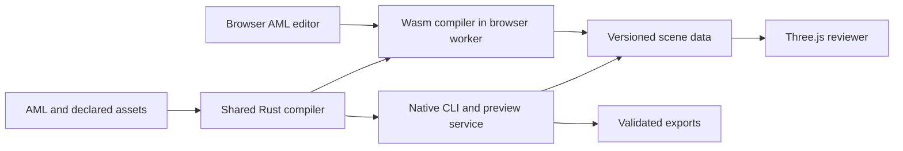

# Rust implementation plan: native and browser Wasm

Implementation priority update (November 13, 2026): the user requested a PoC-first
pace and reduced testing. Build out the native/Wasm workflow using compile checks,
a small end-to-end smoke check and visual inspection. The exhaustive parity,
platform matrix and repeated benchmark requirements below are deferred hardening
criteria, not gates for each experimental implementation step. Keep unsupported
features and unmeasured performance explicit while making the prototype usable.

Status as of the native cutover. The six implementation phases now have working
PoC paths. Rust owns architectural compilation, detailed procedural models and
materials, collision/navigation, portable delivery, parallelism and edit caches,
producers, explicit migration, reconstruction, baking and the local preview host.
The Three.js UI uses Wasm and retains unchanged GPU resources. The old backend
entry points and source have been moved into the local recovery snapshot.

This records implementation coverage. The one-second performance objective and
full legacy feature parity remain separate acceptance items. Broad architectural
warning heuristics, tighter route bounds, destination-engine checks and the
exhaustive browser/platform matrix remain deferred under the user's PoC-first
instruction. See [current evidence and explicit limits](RUST_PROGRESS.md) and
[current supported workflows](IMPLEMENTATION.md).
The requested end state is a full replacement of the non-UI TypeScript/Node
implementation. Rust owns AML parsing, resolution, geometry, dressing, material
generation and caching, validation/navigation, exports, CLI operations and the
local preview server. JavaScript/TypeScript remains only for the web UI and its
build tooling. There will be no permanent Node subprocess, N-API host or embedded
JavaScript engine behind the native CLI.

The existing implementation is a temporary migration oracle. Removing it before
equivalent native behavior exists would discard supported features; retaining it
as a permanent fallback would not satisfy the request. Migrate complete ownership
boundaries, verify them, and remove the superseded non-UI code at final cutover.

## Runtime ownership clarification

Rust owns AML parsing and resolution, model/geometry generation, procedural
material compilation, compiler validation and export. TypeScript owns behavior
after delivery to the web UI, including walking, jumping, crouching, interaction
and camera/view controls. UI movement runs against generated collision data.
The viewer does not depend on a Rust movement API.
## Fidelity and acceptance

The accepted compact-metal courtyard is the starting visual baseline. The user
subsequently authorized visually reviewed performance tradeoffs. The current demo
uses texture density 16 with proportional metal receiver minimums. Keep authored topology, collision/navigation
separation, texture density, shadow resolution, source-linked diagnostics and
deterministic generation. Reproduce the current RNG's actual arithmetic,
including its signed right shift and UTF-16 string hashing; do not substitute a
nominally similar generator that rearranges the scene.

Compare complete geometry and physical behavior, material/source identities,
validation findings and matched rendered views. Cross-language floating-point
differences need explicit classification and evidence, not weakened tests.
Current reference observations and capture identities are documented in
`performance/compact-metal-2026-11-12.md`. The one-second target remains unmet.

Final acceptance requires native release builds to compile the maintained AML
fixtures and default detailed demo, validate and export them, and serve the web
reviewer without a Node executable available. Test cancellation and subsequent
recovery, cache corruption/invalidation, deterministic parallel output and
transactional publication. Measure cold/warm source-to-preview-ready latency,
peak process memory and worker count separately from export packaging and GPU
upload/first frame. Native syntax inspection is not a compilation benchmark.

## Ownership and sequence

| Boundary | Native responsibility | Acceptance evidence |
| --- | --- | --- |
| Source/process foundation | XML limits and locations, diagnostics, deterministic seeds, project creation, CLI framing | Native unit/process tests and frozen reference vectors |
| AML domain and solids | Typed vocabulary, frames/datums/instances, paths/profiles, solid composition, materials and provenance | Maintained authoring fixtures, topology/physical comparisons |
| Procedural scene | Building planning/surveys, fixtures, signs/spans, ground and wall geometry | Seed/layout parity and matched overview/close-up views |
| Appearance | Source codecs, intrinsic recipes, receivers, rasterization, binding, seam closure and caches | Pixel/geometry differential tests, cold/warm performance |
| Validation and delivery | Movement/navigation, findings, UVs, GLB/glTF and optional exporter boundaries | Existing behavior contracts and inspectable native outputs |
| Reviewer service | File watching, cancellation, scene transport, static UI serving | Real-browser edits and native-only launch |
| Remaining tools and cutover | Producers, explicit legacy migration, reconstruction/bake orchestration, native tests/CI, removal of Node backend | Feature inventory resolved; Node absent outside UI |

A source-only reader must label itself as inspection; it cannot report semantic,
geometry or navigation validation success. Unsupported native commands/features
must fail explicitly until their owning phase is implemented. Do not silently
drop unsupported AML or substitute cached demo output for a real compilation.

## Browser compilation and renderer ownership

Live AML editing in the browser is a required migration path. Build the shared
Rust compiler core for both native execution and browser WebAssembly. Keep file
access, process spawning, native serving and platform cache adapters outside that
core; check geometry and codec dependencies on the Wasm target before adoption.
The native CLI must remain usable without a JavaScript runtime.

Run browser compilation in a Web Worker so editing and camera interaction remain
responsive. Associate requests and results with source revisions, discard stale
results, and retain the last valid scene while showing source-linked diagnostics
for an invalid edit. Support cancellation or worker replacement for obsolete
expensive builds. Transfer packed mesh/texture buffers rather than serializing
large numeric arrays as JSON; measure transfer and GPU upload separately from
compilation. Incremental recompilation needs dependency-aware invalidation, not
just delayed input events.

Rust owns procedural models, texture pixels, material definitions and authored
LOD variants. The web renderer owns GPU resources, shader realization of those
materials, lighting, shadows, post-processing and runtime LOD selection. Keep the
scene contract independent of Three.js or Babylon classes, with stable source
identities and explicit units, axes, color spaces and texture-channel conventions.
Preserve the canonical collision/navigation representation when render LOD changes.

Keep Three.js and the accepted lighting configuration during compiler migration.
Compare the accepted courtyard with identical assets, camera views and explicit
lighting budgets; inspect appearance and measure first frame, orbit/walk frame
times, GPU memory and live-edit replacement. Preserve selection, clipping,
diagnostic overlays and resource disposal. Prefer procedural LOD variants
that preserve architectural openings, silhouettes and material seams over assuming
automatic decimation preserves them. Do not count a coarse-only preview as meeting
the detailed-scene one-second target.

Browser threading is a separate deployment concern from native threading. A
worker running Wasm is already useful without shared-memory parallelism. Shared
Wasm memory and a Rayon worker pool require the appropriate browser support and
cross-origin isolation; provide a single-worker path when unavailable and measure
it independently. Native and browser timing targets must be reported separately.

Relevant upstream references: [Wasm in a Web Worker](https://wasm-bindgen.github.io/wasm-bindgen/examples/wasm-in-web-worker.html),
[wasm-bindgen-rayon requirements](https://github.com/RReverser/wasm-bindgen-rayon),
[Three.js LOD](https://threejs.org/docs/pages/LOD.html),
and [Three.js CSM](https://threejs.org/docs/pages/CSM.html).

## Native parallel execution

Share immutable source images and scene plans inside the native process. Plan
order-dependent signs, contacts and spans before parallel emission. Run coarse
host/material jobs with local output buffers and deterministic assembly; avoid
per-face locks and full-scene replicas. Bound outstanding work by estimated memory
as well as cores. Use explicit pool lifetime, cancellation checkpoints and
all-or-nothing publication. Benchmark serial and normal parallel settings on the
same loaded revision; do not assume all phases benefit from additional threads.

The solid-kernel dependency is an explicit migration decision. The upstream
[Manifold project](https://github.com/elalish/manifold) points to
[manifold-rust](https://github.com/larsbrubaker/manifold-rust), a pure-Rust port.
Its compatibility claims must be checked against our fixtures before adopting it;
they are not proof of LevelSpec parity. Other geometry/navigation dependencies
need the same assessment. Native C/C++ dependencies, if needed, are different
from retaining a Node runtime, but must not hide an incomplete Rust ownership
cutover.

## Build environment

Rust 1.100.0 was installed in the ignored `generated/rust-toolchain/` directory for
this worktree, without changing the user's system PATH. Windows GNU was selected
because this machine has no MSVC/Windows SDK toolchain. Rust's
[Windows installation guide](https://rust-lang.github.io/rustup/installation/windows.html)
documents that basic GNU use does not require additional software; crates with
native dependencies may require additional compilers later. This is a local
development setup, not a reason to restrict the application to the GNU target.

## Final component layout

These are ownership boundaries, not instructions to create empty crates up front.
Extract a crate when its first implemented consumer needs the boundary. Domain
code must never depend on CLI, browser, filesystem or renderer adapters.

| Component | Responsibility | Runs in |
| --- | --- | --- |
| `superspec-aml` | AML syntax and typed domain, IDs, units, diagnostics, source spans, RNG and stable data contracts | Native + Wasm |
| `superspec-geometry` | Curves, triangulation, solids, terrain, contacts, collision, navigation and UV kernels, organized into modules | Native + Wasm |
| `superspec-engine` | Resolution, procedural producers/dressing, material recipes/rasterization, validation, dependency graph, scheduling and scene assembly | Native + Wasm |
| `superspec-export` | Runtime JSON, GLB/glTF, SVG, OBJ and native exporter input generation | Native; portable encoders usable in Wasm |
| `superspec-cli` | Commands, filesystem/cache adapters, file watching, static reviewer serving, external tool processes and transactional publishing | Native |
| `superspec-wasm` | Coarse browser bindings, worker session lifecycle, packed result buffers and browser asset/cache adapters | Wasm worker |
| `review`, `viewer`, `website` | AML editor, Three.js rendering, input/cameras, display of diagnostics and UI adapters | Browser JS/TS |

Producer, tracing, reconstruction and bake workflows belong in Rust modules and
CLI subcommands, not a replacement collection of Node scripts. Existing native
tools such as Blender and ericw-tools remain explicit optional prerequisites;
Rust owns their orchestration. Inventory Python tooling as well: retain scripts
required by an external application's API, and move project-owned compilation or
asset-generation logic into Rust. UI build tooling and browser acceptance drivers
may use Node; native runtime, backend tests and asset generation may not.

## Dependency decisions before the large port

The first milestone must resolve these feasibility gates with runnable fixtures.
A successful `cargo check` is not evidence that a browser can execute a kernel.
Pin accepted revisions in lockfiles, record licenses, and retain reproducible
native and Wasm build commands. Prefer pure Rust for the shared core.

| Area | Starting point | Decision gate |
| --- | --- | --- |
| XML | Existing `roxmltree` foundation | Source ranges, input limits, namespace/entity policy, malformed AML and native/browser parity |
| Boolean solids | Evaluate `manifold-rust` against current Manifold behavior | Openings, coplanar/touching solids, thin walls, provenance, robustness, native + actual Wasm execution |
| Curves and triangulation | Port domain algorithms; evaluate a constrained triangulation implementation | Holes, winding, degeneracies, curve tolerances and shared-edge continuity |
| Navigation | Current Recast/Detour behavior is the reference | Tile seams, player clearance, disconnected islands, routes and browser queries; select a portable implementation or explicitly port required algorithms |
| Lightmap UVs | Current xatlas behavior is the reference | Atlas validity, seams, channel conventions, deterministic results and native/browser availability |
| Images | Portable Rust PNG/JPEG decoding and encoding | Exact source pixels, alpha/color-space behavior, malformed inputs, memory limits and Wasm support |
| Parallelism | Native Rayon; separate browser threading build | Bounded memory, deterministic ordering, cancellation and working single-worker browser fallback |

Do not choose a native-only navigation or UV dependency and silently remove the
browser feature later. If no suitable portable library passes, scope the required
Rust port explicitly before proceeding with that subsystem. A C/C++ kernel would
need a separate documented cross-target integration decision; it is not the
default plan or justification for retaining a Node wrapper.

The browser target is initially `wasm32-unknown-unknown`. Its standard library
does not provide native filesystem access or ordinary thread spawning; these
belong in adapters. See the [Rust target documentation](https://doc.rust-lang.org/rustc/platform-support/wasm32-unknown-unknown.html).
Threaded browser builds have additional toolchain and hosting requirements;
validate those separately using the [wasm-bindgen-rayon build instructions](https://github.com/RReverser/wasm-bindgen-rayon).

## Shared compilation and scene contracts

The shared API accepts a source revision, AML text, explicitly supplied asset
identities, compile options and cancellation state. Resolve asset requests in
batches through a host adapter; never call JavaScript per face, vertex or texel.
Use a compilation session for reusable immutable assets and bounded caches. A
fresh session must produce equivalent results without depending on editor history.

The pipeline is parse and resolve -> dependency planning -> structural/procedural
geometry -> surface planning -> material evaluation -> binding/seams -> final
scene assembly and required findings. Navigation and export-specific UV/packaging
are explicit dependent stages. Preserve today's readiness boundary: if a preview
mode requires navigation before it is usable, its readiness includes navigation.
Never silently skip validation work to improve a benchmark.

Keep domain calculations in f64 where the existing implementation uses JavaScript
numbers; use f32 only at established mesh/storage boundaries. Preserve operation
order where observable, seed stream ordering, quantization and sRGB rounding.
No fast-math assumptions or unordered floating reductions during parity work.
Define deterministic traversal/assembly independently of hash-map iteration.

A versioned scene packet contains:

- Source/build revision and compiler identity, manifest lengths and content IDs.
- Packed positions, normals, tangents, UV channels, indices and instance transforms.
- Object/source mappings, material ranges, bounds and stable inspection identities.
- Material definitions and texture buffers with explicit dimensions, formats,
  color spaces, alpha modes, channel packing and UV conventions.
- Separate collision/navigation buffers and source-linked findings with bounds
  and inspection targets; each validation stage reports its actual status.

Use a small structured manifest plus binary buffers, not large numeric JSON
arrays. Version byte order, stride, precision and index width; reject invalid
lengths, indices and unsupported schema versions before GPU allocation. Runtime
JSON exports remain supported separately from this preview transport.

Start with complete scene packets and prove correct lifecycle behavior. Then add
patches containing added/replaced/removed object, material and texture IDs against
an exact base revision. A missing base forces a full snapshot. Publish a coherent
scene revision only after its required assets are available; preserve unchanged
GPU resources and release replaced resources after the swap.

Wasm linear memory is not a freely transferable scene buffer. Budget and measure
the copy into JS-owned transferable buffers; do not promise zero-copy output.
Never retain typed views across memory growth. Later shared-memory transport must
define ownership and lifetime rather than exposing mutable compiler scratch data.

## Live editing, caching and scheduling

The browser editor is a new explicit mode. Existing `preview` remains read-only
against project files. Editor changes initially live in memory, with explicit
download/save behavior; typing must not silently overwrite watched AML. Declared
assets come from the selected project bundle or native service, with clear
missing-asset diagnostics. A hosted editor must compile locally without requiring
a native server or Node backend.

Every edit increments a revision. Coalesce rapid edits, cancel obsolete work,
and allow only the newest accepted revision to update the view. Continue showing
the last valid scene with a visible stale/error state after invalid input.
Retain camera/selection when their source IDs survive. Dispose worker sessions,
decoded images and GPU resources on close or replacement; test recovery after
failure, cancellation, worker restart and graphics-context restoration.

A single-thread Wasm computation cannot receive worker messages while it blocks
the event loop. Use bounded resumable stages where practical; otherwise terminate
and replace the worker for cancellation. Threaded builds may observe a shared
atomic cancellation flag. Do not claim polling an undelivered JS message provides
cooperative cancellation. Preserve session caches only when ownership permits it.

Cache parsed/resolved dependencies, structural plans, decoded source images,
intrinsic materials and assembled outputs separately. Keys include source bytes,
recipe/kernel versions, effective options and all dependent assets. Placement,
contacts, gravity/runoff and neighboring geometry enter keys whenever they affect
appearance. Start with coarse correct invalidation, then refine with evidence.

Native disk caches and browser memory/IndexedDB caches implement the same logical
identity and integrity rules. Bound RAM, in-flight bytes and persistent storage;
handle corrupt entries by rebuilding, preserve real source failures, and treat
browser storage quota failures as cache misses rather than compilation failures.
No caches or job indices may make output depend on completion order.

Plan order-sensitive building relationships, signs and spans before parallel
emission. Schedule independent hosts and material jobs with local arenas/output
buffers and shared immutable images. Assemble by stable IDs in source order.
Avoid nested thread-pool oversubscription. For raster work, assign disjoint tiles
with explicit read halos for filters and seams; parallelize only measured jobs
large enough to cover scheduling overhead. `jobs=1` remains a deterministic
reference path; automatic jobs respect both CPU and memory limits.

LOD is a subsequent renderer feature, not a shortcut for compiler parity. Rust
may generate semantic variants and Three.js may select them, while full-detail
geometry remains available and canonical physics stays unchanged. Defer new LOD
generation and lighting changes until the detailed courtyard baseline passes.

## Implementation milestones and exit checks

Complete each milestone through runnable behavior. Do not translate the entire
source tree first and defer browser integration until the end. Each row records
evidence and unresolved differences before advancing dependent work.

| Stage | Work | Exit check |
| --- | --- | --- |
| 0. Baseline and feasibility | Audit the native foundation; inventory supported commands/fixtures/assets; freeze accepted scene, outputs and views; execute dependency probes above | Foundation tests and release executable verified; real Wasm kernel probes run; numerical policies and unsupported areas recorded |
| 1. Native/Wasm vertical slice | Typed AML subset, primitives, one opening, source diagnostics, scene packet, minimal Three.js adapter and in-memory AML editing | Same fixture compiles natively and in a browser; changing a dimension updates the mesh; malformed AML retains last valid scene; no Node compilation path |
| 2. Complete architectural core | Remaining AML vocabulary, frames/datums/instances, materials, floors/walls/flights, terrain, grading, references and structural validation | Maintained architectural fixtures and Daiban/Dust II compile with equivalent physical behavior and source findings; unknown/unsupported input never disappears silently |
| 3. Detailed courtyard | Port procedural building plans, fixtures, shops, signs/spans, ground/walls, recipes, rasterization, binding and seams; implement native/Wasm asset loading | Default detailed scene produced entirely by Rust on both targets; compare seeds/layout, geometry, materials and matched overview/street/courtyard/cage views |
| 4. Validation and delivery | Complete collision/navigation/route audits, lightmap UVs, portable exports, optional exporter orchestration, CLI/server and file watching | Required runtime checks preserved; exports pass format/fixture checks; native preview serves prebuilt UI without Node; failure/cancel preserves prior output |
| 5. Performance and edit reuse | Native and Wasm pools, bounded caching, dependency invalidation, incremental scene patches, cancellation/recovery | Controlled end-to-end measurements plus deterministic jobs=1/multijob comparisons; local edits reuse only genuinely unaffected work; memory stable across repeated edits |
| 6. Remaining workflows and cutover | Producers/tracing, migration, reconstruction, bake/game delivery, capture/profiling tooling, native tests/CI and documentation | Feature inventory resolved; all superseded backend TS/Node entry points removed; native release smoke tests pass with Node unavailable; web UI alone retains JS/TS tooling |

Stages are dependency-ordered, not an estimate of calendar duration. Surface
unresolved kernel feasibility in stage 0 rather than labeling it a late cleanup.
Introduce coarse parallelism during stage 3 where boundaries are already proven;
stage 5 is the measured optimization and incremental-build acceptance pass.

The first implementation batch after this plan is stage 0 followed by stage 1.
It must deliver a real browser edit loop, not merely XML inspection or a native
helper called from the old Node compiler. Do not add new renderer features in it.

## Performance acceptance

The primary performance objective is the accepted detailed default courtyard
rebuilt after an AML edit and ready for preview in at most 1,000 ms, reusing
unchanged work. The user selected this incremental case as the priority during
phase two. Continue reporting cold and warm full builds separately. This is a
target, not a promised Rust speedup. Keep
texture density, accepted material character, physical geometry and shadow settings
fixed. A completed-scene cache hit or a coarse placeholder is not a successful
full compilation benchmark. The observed prior warm serial median of about
7.1 seconds is revision-specific evidence, not an immutable hardware baseline;
see [the controlled comparisons](performance/compact-metal-2026-11-12.md).

Measure and publish four distinct cases:

1. Fresh process/session, empty generated caches, original assets available.
2. Fresh process/session with decoded/material caches primed, compiling AML again.
3. Existing browser session, localized valid AML edit with dependency reuse.
4. Existing browser session, global edit forcing broad invalidation.

Report native and browser results separately, and label cold versus warm attainment
explicitly. Report cold results even when only incremental rebuilding meets the
target. Record native process
startup and browser Wasm download/initialization separately as well as total user
wait. Start compile timing at request acceptance before parse/asset loading and
end when the complete required scene buffers/findings are ready to hand off.
Report transfer, GPU upload/first frame and export packaging as additional timings.

Use release builds with recorded hardware, source/asset/build fingerprints, worker
count, cache state, peak memory, generated bytes and stage timings. For a final
comparison use at least ten independent samples per primary cold/warm condition,
publish all times and median/range, and interleave controls when feasible. Avoid
concurrent tests or renders. Treat tail estimates from small samples cautiously.
If the target is missed, report the remaining measured cost instead of accepting
a microbenchmark as proof or reducing fidelity without a new decision.

## Deferred full-hardening checklist

Port behavioral coverage alongside each subsystem, with independently frozen
fixtures and differential comparisons to the temporary TS oracle. Preserve exact
IDs, seeds, source locations and decoded pixels where required. Classify geometry
differences by topology, bounds, surfaces, ownership and physical queries rather
than blindly requiring identical triangle order from a different solid kernel.
Set numerical tolerances from existing precision contracts before observing failures;
explicitly review any accepted differences. Use matched renders to assess appearance,
not as a substitute for collision/navigation checks.

Native CI runs formatting, linting, unit/integration/process tests and release
smokes on Windows and Linux, with macOS release verification before claiming its
support. Browser acceptance runs the actual Wasm artifact, tests Chromium/Firefox/
WebKit where supported, and exercises both threaded and single-worker modes.
Keep a non-isolated hosting test for the fallback. Record any unsupported platform
explicitly. Test real cold and mixed-cache execution as well as repeated valid,
invalid and cancelled edits; check eventual resource release and later recovery.

- [ ] All supported AML/domain features and procedural producers have Rust owners.
- [ ] Native and browser compilers use the shared Rust implementation without a
  hidden TS fallback; editor and file-watching workflows both work.
- [ ] Geometry/navigation findings preserve severity, evidence and source targets.
- [ ] CLI init/validate/build/preview/migrate and retained ancillary workflows have
  native commands, coherent help and JSON framing, progress on stderr and exits
  0/1/2/130. Existing output preservation and read-only validation remain intact.
- [ ] Preview service binds locally by default, serves prebuilt UI, watches the
  actual asset dependency set, and does not expose arbitrary filesystem paths.
- [ ] Export stages are transactional; optional external prerequisites remain
  visible and unavailable checks are never reported as passing.
- [ ] Backend tests, benchmarks and asset-generation commands run without Node.
- [ ] Browser code no longer imports TS compiler, geometry, material-generation
  or validation implementations from `src`; UI mechanics remain in JS/TS and
  viewer movement, collision queries and camera controls remain TypeScript.
- [ ] Superseded `src` backend modules, `bin/levelspec.mjs`, backend worker scripts,
  npm command hooks and backend dependencies are removed after their replacements
  pass. Move retained UI entry points before deleting shared directories.
- [ ] Remaining package dependencies are justified by UI build/render/test use;
  old compiler Wasm packages are removed when Rust replacements take ownership.
- [ ] Native releases include or locate the built reviewer assets and require no
  Vite server or runtime npm install. UI development may still use Vite.
- [ ] Temporary oracle runners are removed from normal builds/CI; compact frozen
  evidence and representative fixtures remain, without preserving a second backend.
- [ ] Documentation lists actual native commands and browser requirements; current
  guides are updated at cutover and historical evidence remains labeled historical.

Completion means the full ownership cutover and accepted behavior are verified.
Record performance attainment separately: functional completion must not imply
the one-second target passed when measurements say otherwise.
