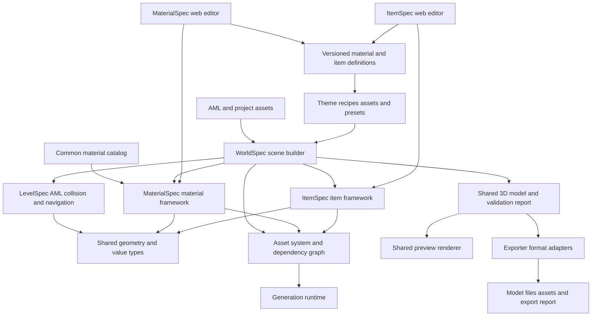

# LevelSpec, MaterialSpec, ItemSpec, WorldSpec and Exporter

Move the five modules to [SuperSpec](https://github.com/tfukaza/superspec) after the Rust port is complete. The LevelSpec module within SuperSpec owns AML parsing and checking, canonical collision, and navigation baking and checks. MaterialSpec and ItemSpec provide frameworks for authoring, previewing and generating materials and items. WorldSpec themes supply the actual materials, items and parameter choices used to build scenes from AML. Exporter converts the shared, format-independent 3D model into selected delivery formats. Keep `kowloon-street@1` as the first WorldSpec theme and use the CLI and browser worker as consumers of the same Rust implementation.

Support those product modules with four shared infrastructure modules covering model and geometry, the asset system, the generation runtime and the preview renderer. Start with internal library boundaries and existing implementations. Independent distribution can follow concrete consumer needs.

This document records the general project direction and proposed boundaries. MaterialSpec is a code-first SDK with procedural material-authoring capabilities inspired by Substance Designer and Substance Painter. Authors write material code using SDK helpers. Language choice, compilation details and delivery milestones remain implementation decisions to validate during extraction.

## Repository ownership and handoff

| Repository | Owns |
| --- | --- |
| **SuperSpec** | AML specification and schema, Rust parser and compiler, validation and navigation, MaterialSpec, ItemSpec, WorldSpec and its themes, Exporter, and the shared infrastructure. Keep implementation tests and focused fixtures with their modules. |
| **LevelSpec** | Authoring and evaluation harnesses, skills, scripts, the shared demo scene library, projects and reference material. Run their workflows against a pinned SuperSpec revision or distribution. |

Begin the migration once the Rust port is complete. From the LevelSpec repository root, run `git clone https://github.com/tfukaza/superspec.git ../superspec` so the checkouts are siblings. Use the completed Rust revision as the extraction baseline. Establish native and browser consumption of SuperSpec before removing the migrated implementation from LevelSpec. Keep the dependency directed from LevelSpec to SuperSpec. Run end-to-end sample-map acceptance from the LevelSpec harness, with focused engine tests runnable from SuperSpec on its own.

Apply the [untangle-codebase skill](https://github.com/caldoai/skills/blob/main/skills/untangle-codebase/SKILL.md) during extraction. Inventory hidden dependencies, unnecessary coupling, surplus code and special cases at the seams, then record the design decision for each group of issues before moving code. Initial seams to review include compiler tests that read sample maps, browser imports of generated Wasm and catalog images, and native asset lookup tied to the source checkout. Put code, fixtures and assets that change together under their owning module. Expose explicit library, artifact and asset interfaces for LevelSpec consumers. Use independent review to check the resulting dependency graph and run the existing behavior checks across the repository boundary.

### Superseded experimental implementations

During extraction, trace duplicate logic from experiments and studies, especially material generators, samplers, shader helpers and bake paths. Use the completed Rust port's supported entry points, current callers and project history to identify the latest implementation that supersedes each older version. Migrate that implementation, update maintained consumers to use it, and remove superseded code and wiring. Record which implementation replaced each duplicate and verify the affected native, browser and demo workflows. Keep study assets and frozen evidence as references where they document a result, and retain distinct implementations when they serve different supported behaviors.

## Module ownership

| Module | Owns | Main inputs and outputs |
| --- | --- | --- |
| **LevelSpec** | AML syntax and extensions, ID and reference rules, structural intent, canonical collision, movement profiles, navmesh generation, and structural, clearance and route checks | AML and a registry → checked document, resolved IDs and source-linked diagnostics. Resolved structure, placed physical contributions and movement profiles → collision data, navmeshes and physical validation results. |
| **MaterialSpec** | Code-first material SDK with PBR contracts, reusable sampling and compositing helpers, physical mapping, compilation, baking, channel conventions and recipe cache keys | Authored material code and imports, typed parameters, seed and optional source maps or surface inputs → compiled material definition, texture assets and mapping metadata. The same inputs can generate a standalone swatch. |
| **ItemSpec** | Item authoring framework with procedural modeling primitives, premade mesh ingestion, material assignments and public item controls | Supplied generator or premade item definition, typed parameters, seed and optional mesh assets → local render geometry, assigned material requests, bounds, attachment points and optional collision. The same inputs can generate a standalone item preview. |
| **WorldSpec** | Theme-authored recipes and item definitions, asset selection, role bindings, parameter presets and project overrides, placement, spatial context and scene assembly | Checked AML, theme/project configuration and supplied assets → scene with provenance, render and collision data, materials and validation status. |
| **Exporter** | Target-format capabilities, export preparation, coordinate and channel conversion, serialization, packaging and export diagnostics | Shared 3D model, resolved assets and export options → files or byte streams, asset manifest and conversion report. |

MaterialSpec maintains a versioned catalog of common materials alongside its framework. Keep the catalog as a separate content module so the framework can run with a caller-supplied catalog. For example, two themes can request the same concrete material and its maps, while each chooses which surfaces use it and what local wear or deposits apply. A theme supplies each role binding and owns its bespoke recipes and presets. Project-specific recipes, meshes and presets can use the same interfaces.

Keep shared geometry kernels in `levelspec-geometry`. Maintain the shared 3D model contract in a dependency-neutral library alongside the portable value types needed at module boundaries, such as vectors, mesh data, asset references and source IDs. LevelSpec, MaterialSpec, ItemSpec, WorldSpec and Exporter use these contracts. ItemSpec assigns materials to named mesh slots using MaterialSpec requests. WorldSpec collects those requests alongside its own, resolves them together and assembles the model. The reviewer and Exporter consume that same model through their own adapters. Filesystem access, cache storage, browser transport and renderer objects stay at adapter boundaries.



### Boundaries that affect scene behavior

- **Stairs.** LevelSpec keeps the AML stair tag, frame and host references, and checks connections and clearances. ItemSpec can provide flight geometry operations from resolved dimensions or rails. Keep the current architecture-specific flight resolver until the local geometry can be extracted with parity. A theme can use the same operations to author a visual stair item with its own tread and railing details.
- **Pipes.** ItemSpec can provide sweep, bend and fitting operations. A Kowloon pipe definition assigns painted steel to the pipe body and galvanized steel to the brackets. It can expose `paintColor` for the body and `weathering` for both materials. The scene author imports the pipe, sets its route and adjusts those item controls as needed. WorldSpec supplies runoff inputs after surveying nearby wall receivers.
- **Surfaces.** MaterialSpec owns reusable samplers, PBR channel generation, layer composition and surface-mapping operators. ItemSpec and WorldSpec supply receiving geometry, effect placement and spatial inputs. WorldSpec binds the results to scene meshes and coordinates continuity across placed items and hosts. Kowloon chooses where facade deposits, signage and shop finishes belong. Preserve site-specific inputs such as ledges and contacts as explicit dependencies where the calculation needs them.
- **Physical intent.** LevelSpec defines how authored solids, terrain and placed physical items contribute collision and walkable surfaces. ItemSpec supplies local collision where declared, and WorldSpec supplies the placements and any project movement profiles to LevelSpec. Themes can read the resulting physical scene to place visual details. Kowloon's `base-wall` replacement affects the visible mesh while the authored wall remains the collision boundary.
- **Navigation.** LevelSpec owns navmesh inputs, bake orchestration and navigation diagnostics, including clearance, connectivity and declared route assertions. Low-level geometry and navigation algorithms can live in `levelspec-geometry`. LevelSpec can bake and check a plain AML level without a theme or material bake. WorldSpec includes the resulting collision, navmesh and check statuses in the assembled scene.

## Shared infrastructure

| Module | Responsibility |
| --- | --- |
| **Model and geometry** | Format-independent scene and mesh contracts, material and asset references, source identity and common geometry operations. Domain modules provide their own authoring and validation rules. |
| **Asset system** | Resolve project, theme and shared-library references, load resources through host adapters, identify content, maintain asset dependencies and derived-artifact storage, and supply assets for generation and export. |
| **Generation runtime** | Execute domain-supplied jobs with dependency tracking, cache lookup, duplicate-request coalescing, bounded scheduling, cancellation, revision publication and profiling. |
| **Preview renderer** | Display the shared model, manage GPU resources and provide reusable lighting, cameras, picking and diagnostic overlays for material, item and world previews. |

MaterialSpec interprets material inputs and ItemSpec interprets mesh inputs through their own compiler or importer operations. The asset system supplies the bytes, identities and dependency relationships those operations need. The generation runtime schedules their work. Editor-specific tools and application state remain with each UI. Filesystem and browser adapters implement loading and delivery for the shared services.

### Asset dependencies and automatic reuse

Maintain a directed dependency graph covering source modules and imports, source images and meshes, decoded resources, compiled materials, parameterized material bakes, generated item meshes, surface mappings and assembled scenes. Record shared dependencies once and allow multiple consumers to reference the same node. Record reverse dependencies for invalidation. Report cyclic build dependencies with the relevant reference chain and source locations.

For example, a pipe and a stair railing can both reference the same painted-steel material. The graph records their dependency on the same compiled material and, when effective bake inputs match, the same baked textures. A hundred placed pipes can share a generated local mesh when its generator inputs match, with separate transforms and source identity for each placement. Repeated scene references automatically reuse the existing work through graph lookup.

Keep source identity, build identity and placement identity explicit. Asset references preserve authored names and provenance, while content hashes identify the resolved source bytes. A compiled-material node includes its source and import identities, compiler version, target and any compile-time parameters or options. A material-bake node additionally includes normalized parameters, relevant seed, quality or resolution, source assets and any spatial inputs that affect its output. A mesh-generation node includes generator identity, parameters and relevant dependencies. Placement and binding data remain separate whenever the generated result is independent of them.

This permits different material parameter sets to share source decoding and compilation while producing their own required bakes. Receiver-specific grime can share its source texture and compiled recipe while keeping distinct mappings. Two uses of the same material name share a finished bake when their effective build inputs match. Preserve these distinctions when exposing reuse statistics to theme authors.

Resolve imports and discover dependencies before dependent work is reused. Any asset or spatial query performed during generation must become an explicit dependency of that job. Replace discovered dependency edges after a successful reevaluation so subsequent changes invalidate the correct consumers. The asset system tracks resource identity and references. The generation runtime tracks executable job dependencies against those resources in the same dependency model.

### Cache and execution lifecycle

On each request, the generation runtime first checks for a completed artifact with the matching build key. Concurrent requests for that key join one in-flight job. On success, publish one immutable artifact through the asset system's storage and return shared references to its consumers. Cache source decoding, material compilation, baking and mesh generation at their respective boundaries so reuse can occur independently at each stage.

Use bounded memory storage and optional persistent storage behind the same interface. Version cache entries by their producing implementation and validate stored data when loading. Publish complete entries atomically where the host supports it. An unusable cache entry can be regenerated. Source or compilation errors remain visible diagnostics. Retain the current session's last valid output while a replacement revision is built.

Track consumer lifetimes for shared jobs and artifacts. Superseding one preview request releases its interest in shared work while remaining consumers can still receive the result. Cancel unneeded work cooperatively. Keep revision checks at publication so a completed obsolete request cannot replace the latest scene. Preview GPU resources have their own lifetime management keyed by artifact identity.

WorldSpec defines scene construction dependencies and stable assembly order. LevelSpec, MaterialSpec, ItemSpec and Exporter define the semantics of their jobs. The runtime schedules ready jobs within concurrency and memory budgets, preserves deterministic assembly and records work rebuilt, reused, joined or invalidated. Begin by extracting the existing session, resolver, cache and renderer machinery, then expand graph granularity using measurements from actual scenes.

### Infrastructure acceptance

Build a scene containing many repeated items sharing a material. Verify one compilation per effective material source, one bake per effective bake key and one local mesh generation per effective geometry key. Repeat requests while work is in flight and verify that they join the same job. Confirm that distinct parameters, source bytes, implementation versions and spatial inputs produce the required distinct artifacts.

Edit a shared source image or helper and verify that dependent material nodes and scene bindings refresh. Edit one item dimension and verify that unrelated material artifacts are reused. Check that obsolete dependency edges are removed, cycles are diagnosed, cache eviction and unusable entries recover, and cancellation of one consumer preserves work needed by another. Compare incremental output with a clean build. Measure graph maintenance, cache lookup, decoding, compilation, baking, memory and end-to-end build time alongside cache hit rates.

## Shared 3D model and Exporter

Maintain our own format-independent 3D model as the handoff between generation, preview and export. Its contract represents scene hierarchy and transforms, reusable meshes and instances, vertex attributes and material slots, resolved material definitions and texture references, and stable source identity. Preserve render visibility, collision contributions, navigation data and validation status as distinct data. Retain structural or solid information required by supported exports alongside render meshes where needed.

Keep the model in meters and right-handed Z-up coordinates, with explicit internal texture and material-channel conventions. Exporter owns conversions required by each destination. Target-format objects, renderer instances and filesystem paths belong in their adapters. A standalone ItemSpec asset can use the same model contract and export path as a WorldSpec scene.

Exporter consumes an immutable model revision and resolved asset references. Each format adapter declares the features it can represent and prepares a derived export view. Coordinate conversion, mesh partitioning, instance expansion, texture packing and other target-specific transformations happen in that view. The canonical model remains available to other consumers and concurrent exports.

### Material conversion and packaging

MaterialSpec owns procedural material compilation and bake execution. Exporter determines which material features the target can carry and requests the necessary bakes through MaterialSpec. This includes compositing layers or decals and baking surface-dependent mappings when the destination requires texture maps. Include recipe identity, receiver inputs and export bake settings in the relevant derived-artifact keys. Reuse common textures and compatible bake results across outputs.

Make unsupported features and conversion losses inspectable through source-linked export diagnostics. Preserve existing rejection behavior for unsupported material effects during extraction. Any added approximation needs an explicit export option and a report identifying the affected objects or materials. Carry identity and metadata in the target where supported, with sidecars for information requiring a separate representation.

Separate conversion from delivery. Core adapters can produce artifact bytes and a manifest; host integrations handle file writing, external conversion tools and publication. Preserve the current CLI's validation, cancellation and staged-publication behavior while moving export responsibilities behind this interface. Browser preview consumes the shared model directly through its renderer adapter.

### Extraction and verification

Use the existing `src/export/vector` boundary and Rust `levelspec-export` crate as the starting points. Establish the shared model contract while retaining the existing CLI behavior and supported output semantics. Extract the current format adapters first, then extend coverage when a concrete delivery target requires it. [Current export contracts](../EXPORTS.md)

Verify that the same generated model can feed the reviewer and multiple exports, with axis conversion applied once per destination. Check geometry, transforms, material appearance, shared asset packaging, source metadata and supported collision/navigation delivery. Confirm that preparing one export leaves the canonical model and another export's inputs intact. Report unavailable format dependencies explicitly. Measure export preparation, material baking, encoding and packaging separately from scene generation.

## MaterialSpec code-first authoring

The dedicated plan defines the SDK helper contracts, AML and model import workflow, and first Material Editor milestone. [MaterialSpec SDK and Material Editor](material-spec.md)

Material source code is the authoritative authoring format. Authors import SDK helpers and reusable material modules, declare public parameters and compose operations to produce material channels. Helpers cover noise, texture sampling, masks, blending, layers, surface mapping and PBR output. Common concrete and grime assets are reusable modules that themes and projects can import and parameterize. Authors can factor repeated logic into their own functions and modules.

The basic workflow is to write source, compile it with its imports and assets, and preview or use the resulting material. A new material can introduce new compositions and reusable logic through code. Public parameter declarations supply types, defaults and ranges for callers and editor controls. Presets record parameter values and reference the source module. Source modules, imports and asset references remain available for subsequent editing.

A web editor provides a code editor, compilation diagnostics, parameter controls and a live material preview. Future graphical authoring controls generate or edit supported source constructs and compile the resulting code through the same path. Keep source compilation usable by CLI and development tooling so authors can also work in their preferred text editor. The dedicated browser editor remains a planned consumer of the SDK.

As a proposed compiler boundary, lower authored material code into a renderer-neutral material representation with explicit operations, parameters, asset dependencies and surface inputs. Use that representation to plan shared work, generate shader evaluation and schedule texture or mask bakes. Preserve source locations for diagnostics. This gives native builds, the browser preview and exporters a common material contract while leaving the authoring language and exact compiler representation open.

Track source modules and their imports as build dependencies alongside parameters and assets. Cache keys include the effective implementation identity. An imported helper change invalidates dependent materials; a parameter edit can reuse compiled code when its structure remains valid. Preserve seeded generation and explicit spatial inputs through the compilation boundary so code-authored materials participate in the same deterministic builds and incremental updates as other assets.

## Materials, layers, decals and surface mapping

Keep appearance, surface mapping and placement independently reusable. A theme can use common concrete and grime assets while supplying its own coverage rules, source edges and placement parameters. The public definitions retain this information so the editor, live renderer and exporter can choose an appropriate evaluation path.

### Base materials and surface layers

A base material defines intrinsic appearance such as concrete aggregate, pores, roughness and color variation. It can include authored weathering defaults. Reusable layers define effects such as grime, wetness, moss, soot, rust and chipped paint, including their contributions to color, roughness, normals and other supported material channels.

Each layer accepts coverage and mapping inputs. Coverage can come from procedural noise, mesh attributes, an authored mask, an item feature or scene context. ItemSpec can apply rust around pipe joints. WorldSpec can apply runoff below an air conditioner or dirt near the ground. MaterialSpec supplies the appearance and mapping operations, while callers supply the selected features, geometry and context. Shared layers and base materials live in the optional common catalog; themes can supply bespoke definitions through the same interfaces.

### Decal definitions and placement

Give decals an explicit definition and placement contract. MaterialSpec owns decal appearance, opacity and material-channel blending. ItemSpec can attach decals to an item and expose their controls. WorldSpec places decals across scene surfaces and applies theme-specific distribution rules. Record receiver selection and projection bounds so effects stay on their intended surfaces.

Localized stains, stickers, signs and graffiti can use decals. Broad grime can use a surface layer. Both can reference the same appearance recipe. Opacity cutouts such as torn sticker silhouettes belong in the appearance definition. Actual openings require geometry and the appropriate LevelSpec physical contribution and checks.

### Gravity-aware edge runoff

Support an authoring operation that selects a source edge, receiving surfaces, a grime recipe, gravity direction, runoff length in meters, strength and seed. The mapping operator projects gravity onto each receiving surface and derives coordinates for position along the source edge and distance travelled downhill. Coverage limits the effect to the selected receiver and runoff extent. Handle finite edge endpoints and downstream coverage explicitly.

For planar receivers, derive these coordinates analytically or store them as additional mesh attributes. Use surface distances in meters to preserve pattern scale across different slopes. Define seed variation through sampling offsets or a shared pattern atlas so individual placements can differ while reusing texture assets.

Twenty differently angled slopes should be able to share one grime texture and compatible shader resources. Each slope supplies its mapping and application parameters. A change in angle updates those inputs without requiring a new grime image. Keep mapping data separate from the base material UVs so concrete and runoff can have independent scale and orientation.

Across curved surfaces or connected faces, a mapping operator may compute paths or a flow field over the mesh. Preserve continuity across face boundaries and record geometry and connectivity dependencies. Shared appearance textures remain reusable even when the mapping is receiver-specific. Horizontal surfaces have no gravity-driven downhill direction; support an authored direction or a separately selected pooling rule. Detailed branching, obstruction and pooling can require a receiver-specific field or mask. Start with planar edge runoff and extend to these cases when a concrete theme requires them.

### Evaluation, caching and ownership

| Data | Owner and reuse |
| --- | --- |
| Base material, grime recipe and source textures | MaterialSpec definitions and catalog assets, shared by content identity. |
| Mapping operator | MaterialSpec implementation, including edge runoff, projection and authored UV mapping. |
| Receiver geometry, source edge and placement | ItemSpec for local item effects; WorldSpec for scene effects and cross-item context. |
| Derived coordinates, flow field or coverage mask | Cached mapping output keyed by the operator implementation and its effective geometry, placement and spatial inputs. |
| Shader resources and baked exports | Renderer and export adapters consume the same resolved appearance, mapping and placement definitions. |

For the first implementation, evaluate planar runoff with shared texture sampling and per-receiver mapping data. Allow baking where an export target requires it or measurements justify it. A baked composition can produce receiver-specific images, so retain the reusable source definitions and measure the resulting texture memory and bake work. Runtime evaluation also has costs in attributes, sampling, blending and draw calls. Select the evaluation path using theme-level measurements and visual checks.

Texture cache identity includes only inputs affecting that texture's pixels. Mapping cache identity includes geometry, selected edges, gravity, physical scale and other inputs affecting coordinates or coverage. A parameter moves into a bake key when a chosen bake incorporates its effect. Declare these dependencies so an angle change can reuse the appearance texture and a grime image edit can reuse the mapping.

### Screen-space material operations

MaterialSpec code can use helpers that depend on the rendered view. Declare the required inputs and capabilities in the compiled material contract. Pixel-footprint filtering and shader derivatives can run in the material's shading stage on a supported backend. Effects that sample scene depth, normals or color also declare the required buffers and evaluation stage. The renderer supplies those inputs and schedules any extra passes. The material editor, item editor and world reviewer use the same renderer contract.

The existing concrete shader is a starting example. It uses screen-space derivatives to filter chipped edges and seams. Keep the underlying material fields reusable and evaluate view-dependent filtering during rendering. Include backend and capability choices in a compiled shader variant's cache key. Supply camera and viewport data at draw time so changes to the view can reuse source assets, compatible compiled shaders and baked textures. [Concrete edge filtering](../../src/materials/concrete/material.ts#L130)

Exporter uses the target's available material features. A bake can evaluate portable material fields at the target texture's sampling footprint. Effects that require scene buffers or a live view need a supported target implementation or an explicit fallback. Report unsupported effects and any selected approximation through the existing export diagnostics contract.

Start by preserving derivative-based filtering in the concrete preview. Verify that changing camera distance or viewport resolution updates filtering while reusing material bakes. Add scene-buffer inputs or extra render passes when a material requires them.

## MaterialSpec and ItemSpec web editors

Give each framework a dedicated browser editor that can open, edit, preview and save content without an AML scene. Start with separate entry points in the same web codebase. Use the shared preview renderer, asset system and generation runtime across the editors and reviewer. The MaterialSpec editor compiles authored source and calls the same material execution path that WorldSpec uses. The ItemSpec editor calls the shared generation path with its own preview inputs. Keep a valid preview visible while reporting errors or replacing an obsolete build.

| Editor | Authoring controls | Preview |
| --- | --- | --- |
| **MaterialSpec** | Write and edit material source using SDK helpers and imports, compile it and inspect source-linked diagnostics. Adjust declared parameters and seed, import source maps, and author layers, decals and mapping operations in code. | Inspect the material on a plane, sphere or sample mesh under adjustable lighting. Check individual PBR channels and tiling at scene scale. For runoff, select a sample edge and vary receiver slope, gravity and length while inspecting coverage and shared texture use. |
| **ItemSpec** | Create a procedural item from a supported generator or import a premade mesh. Edit dimensions, seed, origin, attachment points and collision settings. Assign materials to named slots and choose which material parameters to expose as item controls. | Orbit the item with a meter grid and inspect its bounds, attachment points and collision. Preview the assigned materials and test the same item controls a theme will use. |

MaterialSpec starts with code authoring and compilation, supported by parameter controls driven by the material's declared inputs. Its first authoring workflow should support writing new material logic with SDK helpers and saving and reopening the source. ItemSpec can start with controls driven by its generator's declared inputs. Additional visual authoring tools can follow as the source contracts and editing workflows are exercised.

Save editable, versioned source modules and definitions with their dependency references. A material includes its authored source and imports, declared parameters, presets and asset references. Compilation resolves its layers, mapping requirements and dependencies. An item definition records its generator or mesh, parameters, slot assignments, attached effects and mappings from public item controls to material parameters. Compiled materials, baked maps and preview meshes can accompany those sources as derived assets. WorldSpec consumes the compiled definition and resolves its assets through the same compiler, registry and resolver as the editors. An author can keep the source with a theme or project, or promote it to the shared catalog for reuse.

### Demo scenes and opening AML

Centralize maintained, inspectable AML demos under `demos/` in the LevelSpec repository. Include material studies, item showcases and complete levels. Give each demo a directory with a `scene.aml` entry point and any companion assets it owns. Additional AML files in that directory can represent variants. Reference shared material and item assets through their normal SuperSpec IDs. Keep active project sources with their projects, frozen review evidence with its review, and focused implementation fixtures with the tests that use them.

```text
demos/
  concrete-runoff/
    scene.aml
    textures/
  kowloon-storefront/
    scene.aml
    night.aml
  courtyard/
    scene.aml
    textures/
```

Give the Material Viewer and Level Viewer a common **Open AML** action. ItemSpec's preview can use the same action for item showcases. Every entry is an ordinary AML scene that goes through the shared asset resolver and scene build path. The Level Viewer inspects the assembled scene and its diagnostics. The Material Viewer opens that same scene, lets the user select a surface or material binding, and shows it in context alongside the recipe or PBR channels available for inspection. Material source editing continues through MaterialSpec's code interface. Opening a different viewer changes the tools available for the scene while keeping its authored bindings and placement.

Open a standalone AML file directly. When it needs companions, accept the containing folder or ask for the referenced files, preserving their paths relative to the AML entry point. Use the same loading path for a bundled demo and a user-selected file. A demo browser can list the maintained AML entries from the library and pass the selected one to **Open AML**. Keep scene-specific source and asset imports out of viewer code. Report missing companions with their relative paths and retain the previous valid preview when loading fails.

After the Rust port, inventory the existing demo entry points and move the maintained ones with their companion assets. Start with the courtyard currently bundled into the editor, a material study and a complete sample level. Update their consumers to use the new paths and replace scene-specific buttons with the common open flow. Verify that the same AML opens in both viewers and compiles from the CLI, including after copying a demo folder to another location. Check relative asset resolution, source identity, material bindings and the recovery flow for missing companions.

### Item geometry and material controls

An item should be ready to place with its authored finishes. Its public parameters include native ItemSpec inputs such as `length` and `diameter` in meters, plus any material controls the author chooses to expose, such as `paintColor` and `weathering`. The item definition declares types, defaults and supported ranges. ItemSpec validates the inputs and passes native parameters to its generator. The editor and WorldSpec use the same parameter interface.

The item author maps each exposed material control to one or more compatible MaterialSpec parameters. Keep these mappings declarative initially. ItemSpec validates them against the referenced material versions and resolves the public values into ordinary MaterialSpec requests. A theme can set exposed controls without knowing the item's internal slot names or recipe parameters. An explicit slot replacement can use a compatible mapping, or supply a complete replacement binding with its own parameters.

For example, increasing a straight pipe's `length` regenerates the pipe mesh and updates its end attachment point, bounds and any collision. It can still reuse its painted-steel bake if the material's effective inputs are unchanged. Changing only `paintColor` updates the finish while retaining the pipe geometry.

## AML extensions and checks

Start with an explicit registry of compiled-in extensions shared by native Rust and Wasm. Each extension declares a stable ID and version, its supported AML versions, the tags it owns and their permitted parent scopes, and the checks it provides. LevelSpec owns XML admission, limits, source locations, core tags and ID scopes. An extension decodes its own subtree into a validated payload and reports diagnostics through LevelSpec. If it defines named entities, it declares them through LevelSpec's scope rules. Add serialization for extension payloads wherever the host supports AML round trips.

- Register built-in extensions before parsing. Treat the existing `<dressing theme="kowloon-street@1">` as the compatibility entry point for the Kowloon extension, preserving defaults and accepted AML. The Rust source reader currently rejects XML namespaces. Keep that behavior for this cutover and use registered tag ownership and scope to disambiguate new syntax. Revisit namespace syntax when a concrete extension requires it.
- Reject conflicting registrations at startup. Report unknown tags, unsupported versions and missing required extensions with the offending source location. Keep the core grammar and extension grammar in sync with the existing AML schema entry point. AML selects an installed extension by identity and version. The host controls which implementations are available.
- Run document checks after IDs and references resolve. Run spatial checks against the canonical physical scene and optional scene checks against the assembled output. Give checks a read-only view and require diagnostics with stable codes, source IDs or spans, and bounds and inspection targets where relevant. Report checks as unavailable when their inputs are missing. A skipped navigation check and a sampled, inconclusive check each need their own status.
- Give a standalone LevelSpec checker a profile that can validate any extension registered by the host. The normal CLI and reviewer profile registers Kowloon. A source-only check validates declared parameters and references, while full `validate` retains the geometry and runtime checks of its current workflow as they become available in Rust.

## Scene build and project overrides

1. Register the extensions available in the host profile, then load and parse AML. Resolve the document, select the theme declared in AML or provided by the profile, validate parameters, and collect asset references. Plain AML builds with the base WorldSpec profile. The built-in registry can recognize the Kowloon selector during the same parse.
2. Resolve authored structure and generate and place any explicitly physical items in dependency order. Pass those inputs to LevelSpec to assemble canonical collision, bake the requested navmeshes and run available physical and navigation checks. Retain source IDs and resolved host data for subsequent visual placement.
3. Run theme planning against those hosts, openings, contacts and bounds. Resolve named material roles and item slots, then generate and place items. The theme can provide bespoke assemblies, recipes and premade assets through the same registries used by other content.
4. Resolve finishes, generate required material artifacts, and bind them to render geometry in the shared model. Run checks that require assembled output. Hand the model and diagnostics to the browser adapter or Exporter. Exporter prepares the selected target artifacts and any additional target-dependent material bakes for CLI or browser delivery.

Keep overrides explicit. For a scene material binding, an AML assignment wins, followed by a project override for the role, then the selected theme's role default. The theme can bind that default to a shared material, preserving existing Kowloon defaults this way. For item controls, explicit instance values win, followed by project presets, theme presets and defaults in the item definition. An item keeps its authored material assignments unless the caller explicitly replaces a slot. Pin recipe and item versions with their IDs. Resolve project-local assets through the host's existing asset resolver.

Keep generation deterministic with canonical inputs and stable IDs. Bake keys should include recipe identity and version, parameters, relevant seed, source asset identities and any spatial inputs that change the pixels. WorldSpec defines construction dependencies and output assembly order. The shared generation runtime schedules ready jobs, reuses artifacts and budgets pending work. Preserve stable source order where output depends on it and carry the existing cancellation and publication behavior across the seams.

## Generation performance and hot reload

### Material reuse and mesh binding

MaterialSpec should resolve common materials and bake custom recipes through the same request API. A request carries the recipe or material ID, version, bake parameters, required source assets and optional surface inputs. It returns an immutable material and texture references. ItemSpec prepares the same slot assignments and material requests for standalone preview and scene use. WorldSpec resolves those requests together across all items and scene surfaces. A material-only item control updates the affected requests and bindings while retaining the local mesh and collision. Controls that change geometry as well declare both dependencies.

- **MaterialSpec declares reusable generation.** Compute the bake key from the recipe implementation and version, normalized bake parameters, source asset content, and relevant seed, resolution, mapping and receiver inputs. Register the corresponding jobs with the generation runtime, which coalesces identical requests before raster work and caches completed artifacts through the asset system. Keep binding parameters out of the bake key when they only affect rendering, such as an instance tint or UV offset. A parameter that changes baked pixels belongs in the key.
- **WorldSpec reuses assets across the scene.** A theme chooses how much variety it needs and where to use shared materials, a finite set of variants, or a bespoke bake. WorldSpec groups requests, binds one material definition wherever the complete binding matches, and preserves mesh-local UVs and source identity. For example, several Kowloon buildings can share a concrete texture with different UV offsets. Wall-specific runoff can use a shared grime texture with receiver-specific mapping or coverage. A selected baked composition gets its own artifact when the resulting pixels differ. WorldSpec can reuse repeated local item meshes and submit instances with separate placement and provenance.
- **The renderer reuses GPU resources.** The reviewer can pool textures and compatible material resources by identity and instance meshes where supported. WorldSpec supplies stable references for reuse. The exporter can package shared bytes once even when two bindings differ. These steps reduce transfer and rendering costs independently of generation time.

### Incremental build and publication

Keep a generation-runtime session for the open world or editor. Begin with the existing Rust session and extend it at measured boundaries using the asset and job dependency graph described above. Each build job reads a declared set of inputs and produces immutable output. Use stable job IDs for tracking a host, item instance or receiver across edits, and content keys for deciding whether their work can be reused. Start with structural geometry, theme planning per host, local item geometry, material baking and render binding. Add finer jobs when profiling shows a benefit. A theme with cross-host planning, such as sign clearance or spans, declares the spatial survey it reads. Recompute the shared survey when a dependency changes and reuse downstream outputs whose effective inputs still match.

| Edit | Work to update |
| --- | --- |
| A material's tint or roughness factor applied at render time | Update the affected bindings. Reuse mesh geometry and baked maps. |
| Material source or an imported SDK helper | Recompile dependent material modules and refresh affected shader resources or bakes. Reuse artifacts whose effective dependencies still match. |
| A concrete source map or a parameter used by its bake | Rebuild the affected material artifacts and update their bindings. Reuse physical geometry and navigation where the edit has no physical effect. |
| A grime source texture or appearance parameter | Update affected appearance resources or baked compositions. Reuse unchanged receiver mappings, geometry and physical data. |
| A runoff source edge, receiver slope or gravity direction | Update dependent mapping and coverage, plus compositions that bake those inputs. Reuse shared grime textures. A slope edit that changes physical geometry also updates the dependent LevelSpec data. |
| An export format or target-specific packaging option | Reuse the generated model. Refresh affected export preparation, target-dependent bakes and encoded artifacts. |
| A movement profile or navigation bake setting | Refresh the affected LevelSpec navmesh and checks. Reuse canonical collision, item meshes and materials. |
| One pipe's dimensions or placement | Update that item and the receivers or nearby placement plans that read its geometry. Reuse unrelated hosts and shared material bakes. |
| An AML opening or a theme-wide placement rule | Recompute dependent geometry, surveys and planning. Refresh physical checks for affected inputs when the edit changes collision or walkable surfaces. |

Watch AML, material source modules and imports, saved presets and item definitions, imported assets and theme settings. Apply each change to a new input revision. Cancel or supersede obsolete work and keep the last valid preview until the latest revision succeeds. Source compilation errors retain the prior valid material and expose diagnostics at the relevant source location. Start by publishing complete scene packets through the existing worker while reusing generation inside the session. Add resource or mesh deltas keyed by stable IDs if measurement shows packet transfer or GPU upload is a bottleneck. Stage those updates together so the viewer sees a consistent revision.

Changes to the Rust compiler or generation kernels require rebuilding Wasm and replacing the worker, then reopening the current scene or editor with its authored inputs and view state. Material source edits go through the material compilation path; whether that requires a Wasm rebuild depends on the selected authoring language and compiler design. Parameter edits use the live session when the compiled material supports them. Reuse persisted artifacts only when their implementation identities still match. Start with a compiler build fingerprint for implementation-dependent artifacts. Narrow it to individual modules, recipes or generators if development profiling shows excessive invalidation.

### Measuring and tuning a theme

Use a frozen Kowloon scene to compare a cold build, a warm build and representative single edits. Time planning, item generation, raster work, binding, packet transfer and GPU upload separately. Report jobs rebuilt or reused, unique material bakes and channel texels, copied bytes, peak memory and time to the first updated frame. Compare the result of each incremental edit with a clean build of the same inputs, including diagnostics, render output and collision. Expose these measurements per recipe and host so a theme author can identify which variants, surveys or bespoke finishes drive the cost. Schedule independent jobs with bounded concurrency after eliminating duplicate work. [Existing profiling and cache evidence](../PERFORMANCE.md)

## Migration order

Start this sequence after the Rust port is complete. Use the completed Rust workspace as the source for SuperSpec. The current Rust structure puts AML and the bundled material catalog in `levelspec-core`, with geometry resolution, material inputs and dressing in `levelspec-compiler`. Native CLI and Wasm share that compiler. Use the existing entry points as the compatibility façade while extracting modules in SuperSpec. [Dressing contract](../DRESSING.md)

| Step | Change | Acceptance evidence |
| --- | --- | --- |
| **1. Establish the SuperSpec boundary** | Extract the completed Rust implementation, AML specification, schema and implementation assets to SuperSpec. Resolve cross-repository dependencies found during the inventory. Establish the checked-document, physical-scene, shared model and WorldSpec assembly interfaces. Preserve existing Kowloon AML while moving it through the extension registry. | SuperSpec builds native and Wasm independently. The LevelSpec harness uses the pinned SuperSpec implementation for sample-map workflows. Plain AML and existing dressing AML behave as before. A fixture extension adds one tag and one check, with source-linked errors for missing registration and invalid content. |
| **2. Prove MaterialSpec and its editor** | Establish code-authored modules, composable field helpers and shared compilation and baking contracts. Build the first live editing workflow around chipped concrete on AML scenes and imported models. Add composable grime and planar edge-runoff mapping, then exercise the same helpers with painted metal. [MaterialSpec milestone](material-spec.md#first-milestone-and-acceptance) | Apply one recipe to an imported test panel and an AML scene, inspect intermediate fields, edit code live and save and reopen the source. Verify source-linked errors, physical scale and bake reuse. Preview twenty differently angled receivers sharing one grime image with correct downhill direction. |
| **3. Prove ItemSpec and its editor** | Extract local modeling operations and premade mesh ingestion. Build the first editor workflow around a Kowloon pipe or duct and one premade mesh. Add material assignment and exposed item controls. Defer extraction of structural stair geometry until native flight behavior has a baseline. | Assign the saved material from step 2 and expose one finish control. Reopen the item in the editor, then place it in Kowloon with the authored finish and vary the public control. Verify that finish-only edits reuse geometry and that equal material requests share a bake. Check transforms, attachment points, asset errors and collision intent. |
| **4. Consolidate Kowloon in WorldSpec** | Move remaining theme placement, facade/building and shop assemblies, signs, spans, palettes and bespoke assets under `worldspec/themes/kowloon`. Compose materials and items through the framework interfaces. Promote stable modules to workspace crates when they have independent consumers or build requirements. | Compare plain AML and a frozen Kowloon demo before and after each move. Use a test-only second theme that imports the same concrete and supplies its own recipe parameters and item definition through the same interfaces. Keep CLI and browser contracts stable during the moves. |
| **5. Extract Exporter adapters** | Move target-format preparation and serialization behind the Exporter interface using the shared model established in step 1. Reuse current adapters and MaterialSpec baking. Keep host delivery and external-tool orchestration at the boundary. | Feed the same model to the reviewer and existing supported exports. Check conversion, assets, diagnostics and metadata against current contracts. Confirm independent exports preserve their common input model and existing publication behavior. |
| **6. Verify shared dependencies and incremental generation** | Build out asset and job dependency tracking during steps 2–5. Instrument source decoding, material compilation, shared bakes and local meshes. Cover item, scene and export dependencies using the shared runtime and revision transport. | Run the infrastructure acceptance cases for repeated and concurrent requests, selective invalidation and recovery. Edit a common concrete input and a single placed pipe in the browser. Confirm the expected work is reused, the latest edit wins, and the results match clean builds. Record edit-to-preview time for both cases. Change an export option and verify reuse of the generated model. |

The first migration changes should cover step 1 as a behavior-preserving slice through the completed native and Wasm compiler. Coordinate the SuperSpec extraction and the LevelSpec harness cutover against the same verified revision.

## Acceptance and open decisions

- Freeze the AML and asset bytes used for each comparison. Use Daiban and Dust II for base architecture, existing material and circulation fixtures for focused contracts, and the detailed Kowloon demo for integrated output. Compare physical and render hashes within a backend where stable, source IDs, diagnostics, material bindings and asset manifests. Compare native/Wasm scene packets where parity already exists. For cross-language differences, record tolerances or explain the delta and review matched camera views.
- Keep geometry, render, collision and navigation checks independently observable. Port navmesh generation and runtime audits under the LevelSpec interface. Verify a plain AML bake, the effect of a placed collidable item and reuse after a material-only edit. Compare movement profiles, reachable components, declared route results and source-linked findings against the existing workflow as the Rust port fills in those stages. Measure cold and warm builds on the same inputs to detect extra decoding, copying or baking at the new boundaries.
- Verify runoff on vertical, inclined and horizontal receivers, finite source edges and repeated placements. Check texture scale, receiver clipping, downhill direction and the chosen horizontal-surface behavior. Confirm that changing a slope reuses the shared grime image and changing that image reuses unchanged mappings. Compare incremental results with clean generation, record mapping bytes, unique textures, draw calls and edit-to-preview time, and review the result under matched lighting. Exercise baked output separately for targets that require it.
- Initial design choices are separate SuperSpec implementation and LevelSpec harness repositories, statically registered plugins, existing AML syntax, and project overrides supplied through the build profile or existing AML where possible. A separately distributed plugin format and a standalone project manifest can be decided once a second real theme or consumer exercises the interfaces.
- MaterialSpec's authoring direction is a code-first SDK. Select the authoring language and compilation strategy after checking native and browser execution, source diagnostics, dependency tracking and edit-to-preview time. Treat the proposed compiler representation and migration sequence as design proposals to validate against that direction.
